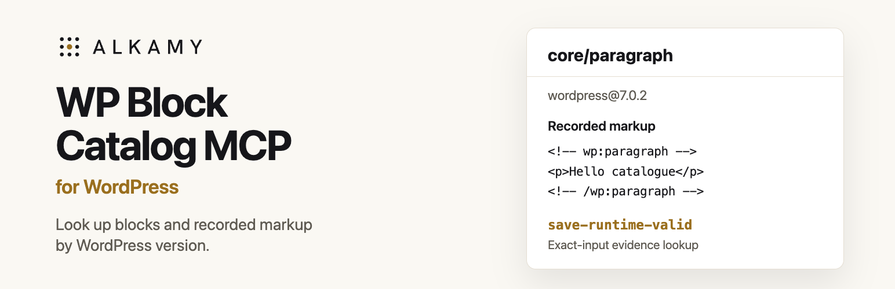

# WP Block Catalog MCP

Look up WordPress blocks for the product versions you actually target.

WP Block Catalog MCP is a read-only [Model Context Protocol](https://modelcontextprotocol.io/)
server by Alkamy. It helps developers and coding agents inspect block attributes,
compare pinned WordPress environments, and retrieve markup backed by stored
runtime evidence. It runs locally from this repository and does not connect to
or change your WordPress site.

## What you can do

- **Find the right block.** Search the catalogue and inspect attributes, supports,
  relationships, variations, and source provenance.
- **Check version differences.** Compare a block across specific WordPress,
  Gutenberg, WooCommerce, and Jetpack environments before using it.
- **Inspect recorded markup.** Retrieve an exact-input fixture that previously
  passed a WordPress save or render check, then check its exact bytes against
  the stored evidence.
- **Investigate registration differences.** See where source metadata, the PHP
  registry, and the editor registry disagree.

<a id="quick-start"></a>

## Get started

Requires **Node.js 20 or newer** and **npm**. The package is not published to npm.

```bash
git clone https://github.com/danielk-am/wp-block-catalog-mcp.git
cd wp-block-catalog-mcp
npm ci
npm run verify
```

Then [configure your MCP client](docs/setup.md) to run
`dist/mcp/server.js` with the bundled catalogue and runtime evidence. The setup
guide includes the complete server configuration and a connection check.

The optional [companion skill](skills/using-wp-block-catalog-mcp) teaches an agent
when and how to use the tools. You can also download it as a ZIP from
[release v0.2.0](https://github.com/danielk-am/wp-block-catalog-mcp/releases/tag/v0.2.0).
Codex CLI was tested with this release. Other clients and Agensi delivery remain
untested.

## Try it with an agent

After connecting the server, ask:

> In wordpress@7.0.2, inspect core/paragraph and retrieve stored markup for
> content "Hello catalogue". Check the returned bytes and explain the evidence.

The [recorded Codex session](docs/demo.md) followed this workflow:

| Step | Tool | What you learn |
| --- | --- | --- |
| Choose the target | `list_environments` | Which pinned environments are available |
| Inspect the block | `get_block` | Its schema and observed registration |
| Retrieve a fixture | `generate_markup` | Whether the exact inputs have stored passed evidence |
| Check its bytes | `validate_markup` | Whether the markup matches a stored passed record |

For the recorded paragraph fixture, the returned markup is:

```html
<!-- wp:paragraph -->
<p>Hello catalogue</p>
<!-- /wp:paragraph -->
```

It carries the label `save-runtime-valid`. Changing the content to an input with
no matching record returns no verified markup.

### What verification means

`generate_markup` retrieves a previously verified record for matching inputs.
`validate_markup` checks exact bytes against stored passed records. Neither tool
runs a fresh WordPress save or render operation. Missing evidence means the
catalogue cannot verify that input; it does not establish that WordPress would
reject it.

Source metadata, PHP registration, editor registration, and markup evidence are
separate observations. A block definition alone is not proof of valid markup.
See the [evidence model](docs/decisions/0001-hybrid-source-and-runtime-catalogue.md)
and [runtime capture notes](docs/runtime-captures.md) for the collection methods.

## Included environments

These are **pinned historical environments**, not the latest product releases.

| Environment | PHP registry | Editor registry | Stored markup evidence |
| --- | ---: | ---: | --- |
| WordPress 7.0.2 | 110 blocks | 109 blocks | Static, deprecated, and dynamic |
| WordPress 7.0.2 + Gutenberg 23.6.2 | 160 blocks | 116 blocks | Static, deprecated, and dynamic |
| WordPress 7.0.2 + WooCommerce 10.9.4 | 285 blocks | 264 blocks | Dynamic |
| WordPress 7.0.2 + Jetpack 16.0.1, disconnected | 110 blocks | 109 blocks | Core static smoke |

The catalogue was rebuilt from pinned source commits on **15 October 2026**.
That date does not refresh the runtime evidence. Jetpack registry captures are
dated 30 July 2026; the other registry bundles and all markup records omit capture
timestamps. Evidence covers recorded cases, not every block or possible input.

## Tools and resources

| Task | Tools |
| --- | --- |
| Discover and inspect | `list_environments`, `search_blocks`, `get_block` |
| Compare environments | `compare_block_versions` |
| Retrieve or check stored markup | `generate_markup`, `validate_markup`, `get_verification_evidence` |
| Inspect registration drift | `get_runtime_drift` |

Compatibility aliases: `get_block_schema`, `get_block_markup`,
`list_block_attributes`, and `search_variations`.

MCP resources: `wp-block-catalog://manifest` and
`wp-block-catalog://blocks/{environment}/{name}`.

## Development

Read [AGENTS.md](AGENTS.md) before contributing. Run the local checks:

```bash
npm run verify
npm audit --omit=dev
git diff --check
```

The [maintenance guide](docs/maintenance.md) covers catalogue rebuilds, source
update checks, release gates, runtime capture, and the public data boundary.
See the [catalogue audit](docs/catalogue-audit.md) for acceptance cases and the
[v0.2.0 readiness record](docs/release-readiness-0.2.0.md) for tested scope and
known dependency advisories.

## Licence

Alkamy's original code and documentation are available under the [MIT licence](LICENSE).
You may use, modify, redistribute, and sell copies, including in commercial
projects, provided you retain the copyright and permission notice. The software
is supplied without warranty.

Upstream-derived metadata, runtime output, and dependencies retain their
applicable licences. See [third-party notices](THIRD_PARTY_NOTICES.md).
